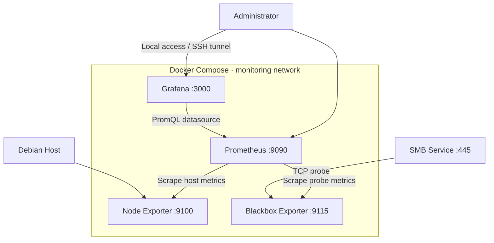

# NAS Observability

A self-hosted NAS monitoring stack built with Docker Compose, Prometheus, Grafana, Node Exporter, and Blackbox Exporter.

## Objectives

- Monitor host CPU, memory, and filesystem utilization.
- Probe SMB TCP service availability.
- Collect and query time-series metrics with Prometheus.
- Visualize infrastructure metrics in Grafana.
- Manage monitoring configuration through Git.

## Architecture



See [docs/architecture.md](docs/architecture.md) for details.

## Technology Stack

| Component | Purpose |
|---|---|
| Docker Compose | Runs the monitoring services |
| Prometheus | Collects and stores metrics |
| Grafana | Visualizes metrics |
| Node Exporter | Exposes host metrics |
| Blackbox Exporter | Probes SMB TCP connectivity |

## Current Dashboard

The configured dashboard currently includes:

- CPU Usage
- Memory Usage
- Root Filesystem Usage
- SMB TCP Availability
- SMB Probe Latency

## Repository Structure

```text
.
├── blackbox/
│   └── blackbox.yml
├── grafana/
│   ├── dashboards/
│   │   └── nas-overview.json
│   └── provisioning/
│       ├── dashboards/
│       │   └── provider.yml
│       └── datasources/
│           └── prometheus.yml
├── prometheus/
│   └── prometheus.yml
├── docs/
│   └── architecture.md
├── .gitignore
├── compose.yml
└── README.md
```

## Prerequisites

- Linux host
- Docker Engine
- Docker Compose plugin
- SMB service reachable from the monitoring stack

Check your installation:

```bash
docker --version
docker compose version
```

## Configuration

Grafana reads its administrator password from `.env` in the project root.

Create this file locally if it does not exist:

```dotenv
GRAFANA_ADMIN_PASSWORD=replace-with-a-strong-unique-password
```

Restrict access:

```bash
chmod 600 .env
```

Use a strong, unique password. Never commit `.env`, passwords, or tokens.

## Deployment

Run from the project directory.

Validate configuration:

```bash
docker compose config -q
```

Start services:

```bash
docker compose up -d
```

Check containers:

```bash
docker compose ps
```

Check service health:

```bash
curl -fsS http://127.0.0.1:9090/-/healthy
curl -fsS http://127.0.0.1:3000/api/health
```

Local interfaces:

- Grafana: http://127.0.0.1:3000
- Prometheus: http://127.0.0.1:9090

Both interfaces are bound to loopback by default. Use a secure remote access method, such as an SSH tunnel, instead of exposing them publicly.

## Verification

1. Open Prometheus and navigate to **Status → Targets**.
2. Confirm configured targets are `UP`.
3. Open Grafana and inspect the NAS Overview dashboard.
4. Check the SMB availability and latency panels.

A healthy Blackbox Exporter does not necessarily mean SMB is available.

## Troubleshooting

Inspect service status and logs:

```bash
docker compose ps
docker compose logs --tail=100
```

Inspect an individual service:

```bash
docker compose logs --tail=100 prometheus
docker compose logs --tail=100 grafana
docker compose logs --tail=100 node-exporter
docker compose logs --tail=100 blackbox-exporter
```

### Grafana cannot connect to Prometheus

- Confirm both containers are running.
- Check `grafana/provisioning/datasources/prometheus.yml`.
- Verify the internal datasource URL is `http://prometheus:9090`.

### SMB probe fails

- Check that SMB listens on TCP port 445.
- Verify firewall rules and container-to-host connectivity.
- Inspect Blackbox Exporter logs and Prometheus targets.

A successful TCP probe confirms connectivity to the port, not SMB authentication or file read/write operations.

### Metrics are missing

- Check Prometheus targets.
- Review exporter logs.
- Validate `prometheus/prometheus.yml`.

## Security and Reliability

- Keep secrets out of version control.
- Keep Grafana and Prometheus bound to loopback unless remote exposure is deliberately secured.
- Review firewall rules before modifying network access.
- Pin and test container image versions before long-term deployment.
- Back up configuration and persistent monitoring data.

## Roadmap

- Add storage capacity and filesystem trend panels.
- Configure alert rules and notification delivery.
- Test service failure detection and recovery.
- Pin validated container image versions.
- Document backup and recovery procedures.

## License

No license has been added yet. Add a license before explicitly granting others permission to reuse or redistribute this project.
